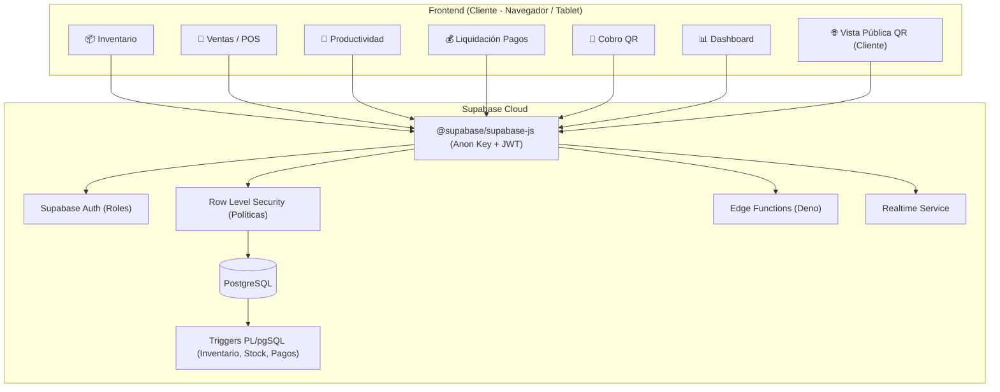
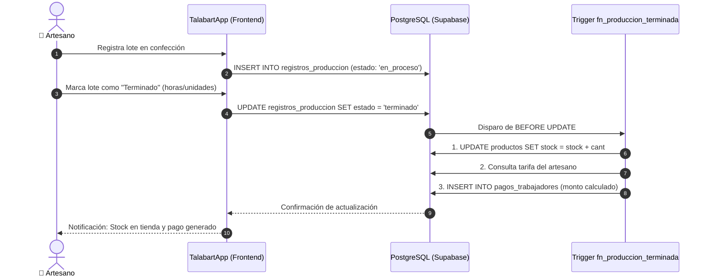
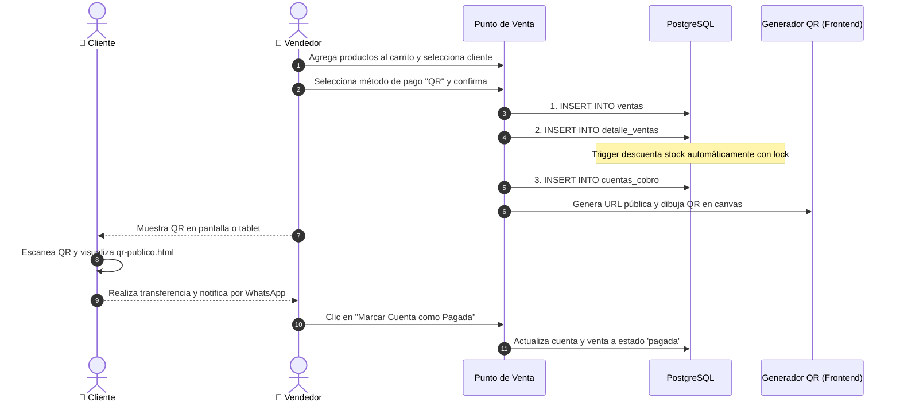

# 🐴 TalabartApp — Sistema de Gestión para Talabartería

Sistema integral de gestión comercial, inventario, ventas y productividad artesanal para talleres y tiendas de talabartería (manufactura y retail de artículos de cuero).

Desarrollado bajo una arquitectura **JAMstack / BaaS (Backend-as-a-Service)** ligera y de alto rendimiento: frontend en **HTML5, CSS3 y JavaScript puro (Vanilla JS)** consumiendo directamente **Supabase** (PostgreSQL, Auth, RLS, Triggers y Edge Functions).

---

## 📋 Tabla de Contenidos
- [Características Principales](#-características-principales)
- [Stack Tecnológico](#-stack-tecnológico)
- [Arquitectura de Software](#-arquitectura-de-software)
- [Estructura del Proyecto](#-estructura-del-proyecto)
- [Esquema de Base de Datos y Automatizaciones](#-esquema-de-base-de-datos-y-automatizaciones)
- [Guía de Instalación y Configuración](#-guía-de-instalación-y-configuración)
- [Roles y Permisos (RLS)](#-roles-y-permisos-rls)
- [Flujos Clave del Negocio](#-flujos-clave-del-negocio)

---

## 🚀 Características Principales

### 1. 📦 Inventario de Productos y Cuero
- **Catálogo de Artículos**: Registro de productos de cuero (monturas, cinturones, bolsos, billeteras, correas, etc.).
- **Origen de Fabricación**: Clasificación de productos según su procedencia:
  - `fabricado`: Elaborado internamente en el taller por artesanos.
  - `comprado`: Adquirido terminado a distribuidores/proveedores externos.
- **Control de Stock y Estados**: Estados dinámicos (`disponible`, `en_produccion`, `agotado`).
- **Sincronización en Tiempo Real**: Reflejo inmediato de cambios de stock mediante **Supabase Realtime**.
- **Gestión de Categorías**: Creación y organización de líneas de productos de cuero.

### 2. 🛒 Ventas y Terminal Punto de Venta (POS)
- **Terminal POS Interactivo**: Selección rápida de artículos, control de unidades en tiempo real y cálculo de subtotales.
- **Descuento Atómico de Stock**: Decremento garantizado a nivel de base de datos con bloqueo `FOR UPDATE` para evitar sobreventa o inconsistencias.
- **Historial de Ventas**: Filtros por método de pago (`efectivo`, `transferencia`, `tarjeta`, `qr`), rangos de fechas y estado.
- **Comprobante de Venta**: Modal con desglose de factura listo para imprimir.

### 3. 👥 Directorio de Clientes
- Registro de clientes con historial de compras, teléfono, correo y notas de preferencia en tipos de cuero o medidas.

### 4. 📱 Cobro con Código QR
- **Generación en Frontend**: Creación de códigos QR instantáneos utilizando `qrcode.js`.
- **Vista Pública para el Cliente (`qr-publico.html`)**: Al escanear el QR con un smartphone, el cliente accede a una página web responsive independiente donde visualiza el detalle de su compra, el monto exacto a pagar, las cuentas bancarias para transferencia (Bancolombia, Nequi, Daviplata) y un botón directo para reportar el pago por WhatsApp.
- **Control de Estado de Cobro**: Actualización del estado a `pagada` tanto en la cuenta de cobro como en la venta relacionada.

### 5. 🔨 Productividad de Trabajadores y Liquidación de Pagos
- **Registro de Órdenes de Confección**: Asignación de lotes de confección a artesanos con especificación de cantidades.
- **Automatización Atómica por Trigger**:
  - Al marcar un lote como `terminado`, el trigger en PostgreSQL suma automáticamente el stock al inventario disponible.
  - Consulta la tarifa del artesano (`por_hora` o `por_unidad`).
  - Liquida la remuneración y crea el registro de pago en `pagos_trabajadores`.
- **Panel de Pagos**: Métricas financieras (Total generado, Pendiente de pago y Desembolsado), con generación de recibos de pago imprimibles.

### 6. 📊 Dashboard Administrativo
- Métricas clave del mes (ventas totales, productos en almacén, órdenes activas en taller y cuentas pendientes por cobrar).
- Panel de **Alertas de Stock Bajo** con acciones directas de reabastecimiento u orden de confección.

---

## 🛠️ Stack Tecnológico

| Capa | Tecnología | Justificación |
|---|---|---|
| **Frontend** | HTML5 semántico + CSS3 (Variables y Flexbox/Grid) + Vanilla JS (ES Modules) | Cero dependencias pesadas, carga instantánea, compatible con cualquier navegador y dispositivo móvil/tablet en el taller. |
| **BaaS / Backend** | Supabase | Aprovisiona base de datos relacional, capa de autenticación y almacenamiento sin requerir un servidor dedicado. |
| **Base de Datos** | PostgreSQL | Integridad referencial fuerte, transacciones ACID y extensiones UUID. |
| **Lógica de Negocio Crítica** | PL/pgSQL Triggers & Functions | La lógica transaccional de inventario y nómina vive en la base de datos para garantizar consistencia. |
| **Seguridad de Datos** | Row Level Security (RLS) | Restricción de lectura y escritura por fila según el rol del usuario autenticado. |
| **Edge Functions** | Deno / TypeScript (Supabase Functions) | Procesamiento seguro de reportes y nómina con la clave de servicio (`service_role`). |
| **Generación QR** | `qrcode.js` (vía CDN) | Generación rápida de códigos QR directamente en el navegador del vendedor. |

---

## 📐 Arquitectura de Software



### Justificación de la Distribución de Lógica
- **En el Frontend**: Experiencia de usuario, validaciones visuales, formularios, renderizado del QR en canvas y navegación SPA.
- **En Triggers / PL/pgSQL**: Todo cálculo que afecte inventario, stock o pagos de nómina. Esto evita condiciones de carrera (*race conditions*) y asegura que no haya desincronizaciones aunque se modifiquen datos desde distintas terminales.
- **En Edge Functions**: Reportes sensibles o tareas administrativas que requieran saltarse las restricciones de RLS mediante la clave `service_role`.

---

## 📁 Estructura del Proyecto

```
talabartapp2/
├── index.html                                 # Shell SPA principal con sidebar responsive
├── css/
│   ├── global.css                             # Variables de diseño (paleta cuero), reset y fuentes
│   ├── components.css                         # Botones, tablas, modales, toasts, badges
│   └── layout.css                             # Sidebar, layout principal y responsive
├── js/
│   ├── config.js                              # URL de Supabase y Anon Key pública
│   ├── supabase-client.js                     # Inicialización de createClient
│   ├── auth.js                                # Manejo de sesión, perfil y guards de rol
│   ├── router.js                              # Enrutador SPA basado en hash (#/ruta)
│   ├── utils.js                               # Formateo de moneda (COP), fechas y toasts
│   ├── app.js                                 # Registro de rutas e inicialización global
│   └── modules/
│       ├── auth/login.js                      # Login con email y contraseña
│       ├── dashboard/dashboard.js             # Métricas y alertas de stock bajo
│       ├── inventario/inventario.js           # Catálogo, categorías y realtime
│       ├── clientes/clientes.js               # Directorio de clientes
│       ├── ventas/ventas.js                   # Listado de ventas y terminal POS
│       ├── qr/qr.js                           # Gestión de cobros y generación de QR
│       └── productividad/
│           ├── productividad.js               # Registro y cierre de lotes artesanales
│           └── pagos.js                       # Liquidación de pagos y comprobantes
├── modules/
│   ├── auth/login.html                        # Formulario de inicio de sesión
│   ├── dashboard/dashboard.html               # Tablero principal de indicadores
│   ├── inventario/inventario.html             # Vista de inventario
│   ├── clientes/clientes.html                 # Vista de clientes
│   ├── ventas/
│   │   ├── ventas.html                        # Listado histórico de ventas
│   │   └── nueva-venta.html                   # Punto de venta (POS)
│   ├── qr/
│   │   ├── qr.html                            # Panel de control de cobro QR
│   │   └── qr-publico.html                    # Vista pública para el cliente final
│   └── productividad/
│       ├── productividad.html                 # Control de lotes de trabajo
│       └── pagos.html                         # Histórico de remuneraciones
└── supabase/
    ├── migrations/
    │   ├── 001_schema.sql                     # Tablas, relaciones, enums e índices
    │   ├── 002_triggers.sql                   # Triggers de inventario, stock y nómina
    │   └── 003_rls.sql                        # Políticas Row Level Security por rol
    └── functions/
        └── calcular-pago/index.ts             # Edge Function en Deno para consolidación
```

---

## 🗄️ Esquema de Base de Datos y Automatizaciones

### Tablas Principales
1. `usuarios`: Extensión del usuario de autenticación (`auth.users`) con `rol`, tarifas (`tarifa_hora`, `tarifa_unidad`) y `tipo_pago`.
2. `categorias`: Categorías de productos de cuero.
3. `productos`: Catálogo con `precio`, `stock`, `estado`, `origen` e `imagen_url`.
4. `clientes`: Datos de contacto de compradores.
5. `ventas` y `detalle_ventas`: Encabezado y líneas de productos vendidos.
6. `cuentas_cobro`: Cuentas generadas para pago por QR y su estado.
7. `registros_produccion`: Registro de lotes de confección artesanal.
8. `pagos_trabajadores`: Liquidaciones calculadas automáticamente para cada trabajador.
9. `audit_log`: Registro histórico de auditoría ante inserciones, modificaciones o bajas.

### Triggers Automatizados (PL/pgSQL)
- **`trg_produccion_terminada`**: Al actualizar `registros_produccion.estado = 'terminado'`:
  - Incrementa automáticamente el stock del producto en `productos`.
  - Calcula el pago del trabajador (`horas × tarifa_hora` o `unidades × tarifa_unidad`).
  - Inserta el registro en `pagos_trabajadores`.
- **`trg_descontar_stock`**: Al insertar en `detalle_ventas`:
  - Aplica un bloqueo `FOR UPDATE` sobre el producto para verificar existencia.
  - Descuenta la cantidad vendida y marca como `agotado` si el stock llega a 0.
- **`trg_recalcular_total`**: Recalcula el total de la venta sumando los subtotales de sus detalles.
- **`trg_set_updated_at`**: Mantiene actualizada la columna `updated_at` en todas las tablas.

---

## ⚙️ Guía de Instalación y Configuración

### 1. Configurar Supabase
1. Ingresa a [supabase.com](https://supabase.com) y crea un nuevo proyecto.
2. Abre la sección **SQL Editor** en el panel de control de Supabase.
3. Ejecuta en orden los tres archivos de migración ubicados en `supabase/migrations/`:
   - `001_schema.sql`
   - `002_triggers.sql`
   - `003_rls.sql`

### 2. Configurar las Credenciales en el Frontend
Abre el archivo `js/config.js` y coloca la URL del proyecto y la **anon key**:
```javascript
export const SUPABASE_URL = 'https://TU-PROYECTO.supabase.co';
export const SUPABASE_ANON_KEY = 'TU-ANON-KEY-AQUI';

export const APP_CONFIG = {
    nombre: 'TalabartApp',
    version: '1.0.0',
    itemsPorPagina: 20,
    moneda: 'COP',          // Moneda (COP, MXN, USD, EUR, etc.)
    formatoFecha: 'es-CO'
};
```

### 3. Crear el Primer Usuario Administrador
1. En el panel de Supabase ve a **Authentication > Users** y crea un usuario con correo y contraseña.
2. En el **SQL Editor**, asigna el rol de administrador en la tabla `public.usuarios`:
   ```sql
   INSERT INTO public.usuarios (id, nombre, rol)
   VALUES ('UUID-DEL-USUARIO-CREADO', 'Administrador Taller', 'admin');
   ```

### 4. Ejecutar la Aplicación Localmente
Al ser una aplicación web estática, puedes servirla con cualquier servidor HTTP local:

**Con Python:**
```bash
python -m http.server 8000
```

**Con Node.js (npx):**
```bash
npx serve .
```

Abre tu navegador en: `http://localhost:8000`.

---

## 🔐 Roles y Permisos (RLS)

El sistema implementa **Row Level Security (RLS)** estricto en todas las tablas de PostgreSQL:

| Módulo / Tabla | Administrador (`admin`) | Vendedor (`vendedor`) | Trabajador / Artesano (`trabajador`) |
|---|---|---|---|
| **Inventario** (`productos`) | CRUD Completo | Solo Lectura | Solo Lectura |
| **Ventas** (`ventas`, `detalle`) | CRUD Completo | Registrar y Consultar | Sin acceso |
| **Clientes** (`clientes`) | CRUD Completo | CRUD Completo | Sin acceso |
| **Cobro QR** (`cuentas_cobro`) | CRUD Completo | Crear y Consultar | Vista pública por ID (anónimo) |
| **Productividad** (`registros_produccion`) | Gestiona todos | Sin acceso | Solo crea y edita sus propios lotes |
| **Nómina** (`pagos_trabajadores`) | Consulta y marca desembolsos | Sin acceso | Solo consulta sus pagos liquidados |

---

## 🔄 Flujos Clave del Negocio

### Flujo 1: Confección Artesanal → Stock → Liquidación


### Flujo 2: Compra en Mostrador → Descuento de Stock → Cobro QR


---

## 📄 Licencia
Este proyecto está disponible bajo la licencia MIT. Diseñado para pequeños y medianos talleres artesanales de marroquinería y talabartería.
