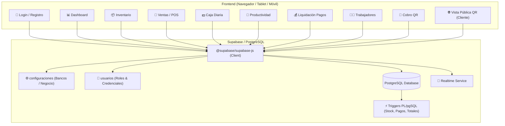
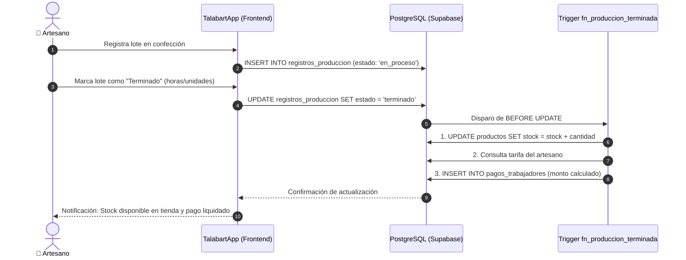
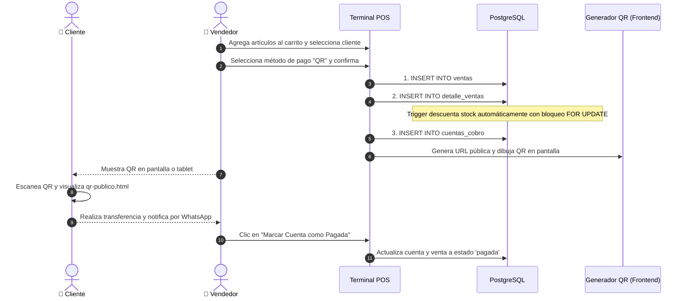

# 🐴 TalabartApp — Sistema de Gestión para Talabartería

Sistema integral de gestión comercial, inventario, punto de venta (POS), control de caja diaria, cobro con código QR y productividad artesanal para talleres y tiendas de talabartería (manufactura y retail de artículos de cuero).

Desarrollado bajo una arquitectura **JAMstack / BaaS (Backend-as-a-Service)** ligera y de alto rendimiento: frontend en **HTML5, CSS3 y JavaScript puro (Vanilla JS / ES Modules)** consumiendo directamente **Supabase** (PostgreSQL, Triggers, Realtime y Edge Functions).

---

## 📋 Tabla de Contenidos
- [Características Principales](#-características-principales)
- [Stack Tecnológico](#-stack-tecnológico)
- [Variables de Entorno (.env)](#-variables-de-entorno-env)
- [Arquitectura de Software](#-arquitectura-de-software)
- [Estructura del Proyecto](#-estructura-del-proyecto)
- [Esquema de Base de Datos y Automatizaciones](#-esquema-de-base-de-datos-y-automatizaciones)
- [Guía de Instalación y Configuración](#-guía-de-instalación-y-configuración)
- [Roles y Permisos](#-roles-y-permisos)
- [Flujos Clave del Negocio](#-flujos-clave-del-negocio)
- [Licencia](#-licencia)

---

## 🚀 Características Principales

### 1. 📦 Inventario de Productos y Cueros Especializados
- **Catálogo Especializado de Taller**: Registro completo de piezas de cuero y monturas (vaquetas, cinturones, bolsos, billeteras, aperos, riendas).
- **Atributos de Marroquinería**: Clasificación por **Tipo de Cuero / Acabado** (Vaqueta Vegetal, Cuero Graso/Pull-up, Badana/Napa, Carnaza/Nobuck) y **Tono / Color** (Café Moro, Miel, Habano, Negro, Suela, Natural).
- **Etiquetas Visuales**: Cada producto en el catálogo exhibe insignias con el tipo de cuero y tono para rápida identificación en almacén.
- **Origen de Fabricación**: Clasificación según procedencia:
  - `fabricado`: Elaborado internamente en el taller por artesanos/talabarteros.
  - `comprado`: Adquirido terminado a distribuidores o proveedores externos.
- **Control de Stock y Estados**: Estados automáticos (`disponible`, `en_produccion`, `agotado`).
- **Sincronización en Tiempo Real**: Reflejo inmediato de cambios de inventario mediante **Supabase Realtime**.
- **Gestión de Categorías**: Organización por líneas de manufactura (Monturas & Aperos, Cinturones & Reatas, Marroquinería Fina, Bolsos & Morrales, Insumos & Herrajes).

### 2. 🛒 Ventas, Facturación y Garantía de Taller
- **Terminal POS Interactivo**: Búsqueda rápida de artículos, control de unidades en tiempo real y cálculo automático de subtotales.
- **Descuento Atómico de Stock**: Decremento garantizado a nivel de base de datos con bloqueo `FOR UPDATE` para evitar inconsistencias o sobreventa.
- **Historial de Ventas**: Filtros por método de pago (`efectivo`, `transferencia`, `tarjeta`, `qr`), rangos de fechas y estado de cobro.
- **Comprobante de Venta & Garantía Artesanal**: Comprobante de venta comercial listo para impresión térmica o ticket, con encabezado de taller de régimen simplificado y clausulado de **Garantía Artesanal (6 meses en costuras y herrajes) y Cuidados del Cuero**.

### 3. 💵 Módulo de Caja Diaria del Taller
- **Apertura de Caja**: Registro de turno con monto inicial en efectivo.
- **Categorización de Gastos de Taller**: Registro de egresos e ingresos clasificados específicamente para la industria (`Cueros y Pieles`, `Herrajes y Hebillas`, `Insumos y Químicos`, `Herramientas`, `Fletes y Envíos`, `Pago a Artesano`, `Gastos Taller`).
- **Consolidación en Tiempo Real**: Sumatoria automática de ventas del día en efectivo + ingresos extra - egresos.
- **Arqueo y Cierre**: Comparación entre saldo esperado y efectivo real en caja, registrando diferencias y observaciones.

### 4. 👥 Directorio de Clientes
- Registro de clientes con historial de compras, teléfono, correo y notas de preferencia en tipos de cuero o medidas personalizadas.

### 5. 📱 Cobro con Código QR Dinámico
- **Generación en Frontend**: Creación de códigos QR instantáneos utilizando `qrcode.js`.
- **Cuentas Bancarias Configurables**: Panel administrativo para definir las cuentas de recepción (Bancolombia, Nequi, Daviplata, etc.) guardadas en la base de datos.
- **Vista Pública para el Cliente (`qr-publico.html`)**: Al escanear el QR desde su celular, el cliente visualiza el detalle de su compra, el total a pagar, los datos bancarios y un botón para notificar el pago por WhatsApp.
- **Control de Estado de Cobro**: Actualización del estado a `pagada` en la cuenta de cobro y en la venta correspondiente.

### 6. 🔨 Productividad Artesanal y Liquidación de Pagos
- **Registro de Órdenes de Confección**: Asignación de lotes de confección a artesanos con especificación de cantidades.
- **Automatización Atómica por Trigger**:
  - Al marcar un lote como `terminado`, el trigger en PostgreSQL suma automáticamente el stock al inventario disponible.
  - Consulta la tarifa del artesano (`por_hora` o `por_unidad`).
  - Liquida la remuneración y genera el registro en `pagos_trabajadores`.
- **Panel de Pagos**: Métricas financieras (Total generado, Pendiente de pago y Desembolsado), con generación de recibos imprimibles.

### 7. 🧑‍🏭 Gestión Completa de Trabajadores y Artesanos
- **Alta y Registro**: Creación de nuevos trabajadores y artesanos con datos completos (nombre, cédula/documento, teléfono, email, especialidad y notas).
- **Edición Integral**: Modificación de tarifas (`tarifa_hora`, `tarifa_unidad`), modalidad de remuneración (`por_hora`, `por_unidad`), rol y datos personales en cualquier momento.
- **Borrado y Desactivación Segura**: Posibilidad de eliminar trabajadores o marcarlos como inactivos de forma inteligente si cuentan con historial previo de confecciones o pagos.
- **Asignación en Taller**: Control de disponibilidad activa para el módulo de productividad artesanal.

### 8. 🔐 Autenticación Centralizada en Producción (Supabase Auth)
- Acceso exclusivo para personal autorizado mediante **Supabase Authentication**.
- **Sin registro público**: Se eliminó la opción de autoregistro para garantizar la seguridad en producción.
- La creación y administración de usuarios (correos, contraseñas y accesos) se realiza de forma centralizada por el administrador directamente desde la consola de Supabase.
- Sincronización automática de perfil con la base de datos `public.usuarios` para roles (`admin`, `vendedor`, `trabajador`) y tarifas de nómina.

### 9. 📊 Dashboard Administrativo
- Indicadores clave del mes: ventas totales, productos en almacén, órdenes activas en taller y cuentas pendientes por cobrar.
- Panel de **Alertas de Stock Bajo** con acciones directas de reabastecimiento o confección.

---

## 🛠️ Stack Tecnológico

| Capa | Tecnología | Justificación |
|---|---|---|
| **Frontend** | HTML5 semántico + CSS3 (Variables, Flexbox y Grid) + Vanilla JS (ES Modules) | Sin dependencias de compilación pesadas, carga instantánea, compatible con cualquier navegador, PC de mostrador, tablet o móvil en el taller. |
| **BaaS / Backend** | Supabase | Aprovisiona base de datos relacional, API instantánea, Realtime y funciones sin requerir un servidor dedicado. |
| **Base de Datos** | PostgreSQL 15+ | Integridad referencial fuerte, transacciones ACID, tipos JSONB y extensiones UUID. |
| **Lógica de Negocio** | PL/pgSQL Triggers & Functions | Las operaciones críticas de inventario, stock y liquidaciones viven en la base de datos para garantizar consistencia absoluta. |
| **Configuración** | `.env` / `js/config.js` | Configuración desacoplada y adaptable para entornos locales o de despliegue. |
| **Generación QR** | `qrcode.js` (vía CDN) | Generación instantánea de códigos QR en el cliente sin latencia de red. |

---

## 🔑 Variables de Entorno (.env)

El proyecto incluye soporte para variables de entorno para centralizar las credenciales de conexión y parámetros generales.

### Archivos de Configuración
- **`.env`**: Archivo local con las variables activas del entorno. *(No se debe subir a repositorios públicos si contiene credenciales privadas)*.
- **`.env.example`**: Plantilla de referencia para documentar las variables necesarias.

### Variables Disponibles

```env
# ============================================================
# Configuración de Supabase
# ============================================================
# URL del proyecto en Supabase (obtenida en Project Settings > API)
SUPABASE_URL=https://TU-PROYECTO.supabase.co

# Clave pública anónima (Anon Public Key) para consultas del frontend
SUPABASE_ANON_KEY=tu_anon_key_publica_aqui

# (Opcional) Clave de servicio para Edge Functions o scripts de administración
# SUPABASE_SERVICE_ROLE_KEY=tu_service_role_key_privada

# ============================================================
# Configuración de la Aplicación
# ============================================================
APP_NAME=TalabartApp
APP_CURRENCY=COP
APP_LOCALE=es-CO
PORT=8000
```

> [!TIP]
> En entornos web estáticos directos (como abrir con un servidor local), las variables están vinculadas en `js/config.js` y pueden ser sobreescritas mediante `window.__ENV__` o actualizando `js/config.js` con los mismos valores definidos en `.env`.

---

## 📐 Arquitectura de Software



---

## 📁 Estructura del Proyecto

```
talabartapp2/
├── .env                                       # Variables de entorno activas
├── .env.example                               # Plantilla de variables de entorno
├── .gitignore                                 # Exclusiones de git (ignora .env y temporales)
├── index.html                                 # Shell SPA principal con navegación responsive
├── README.md                                  # Documentación técnica completa
├── css/
│   ├── global.css                             # Variables de diseño (paleta cuero), reset y tipografía
│   ├── components.css                         # Botones, tablas, modales, alertas, badges y formularios
│   └── layout.css                             # Estructura del layout, sidebar y responsive
├── js/
│   ├── config.js                              # Configuración central (Supabase URL, Anon Key, formato)
│   ├── supabase-client.js                     # Inicialización del cliente Supabase
│   ├── auth.js                                # Autenticación local, perfiles y control de roles
│   ├── router.js                              # Enrutador SPA basado en hash (#/ruta)
│   ├── utils.js                               # Formateo de moneda (COP), fechas y notificaciones
│   ├── app.js                                 # Registro de rutas e inicialización general
│   └── modules/
│       ├── auth/login.js                      # Controlador de inicio de sesión y registro
│       ├── dashboard/dashboard.js             # Métricas, resúmenes y alertas de inventario
│       ├── inventario/inventario.js           # Catálogo de productos, categorías y realtime
│       ├── clientes/clientes.js               # Directorio y gestión de clientes
│       ├── ventas/ventas.js                   # Histórico de ventas y terminal POS
│       ├── caja/caja.js                       # Apertura, movimientos y arqueo de caja
│       ├── trabajadores/trabajadores.js       # Administración y tarifas de artesanos
│       ├── qr/qr.js                           # Generación de QR y configuración de cuentas bancarias
│       └── productividad/
│           ├── productividad.js               # Registro y finalización de lotes de confección
│           └── pagos.js                       # Liquidación de remuneraciones y comprobantes
├── modules/
│   ├── auth/login.html                        # Vistas de Iniciar Sesión y Crear Cuenta
│   ├── dashboard/dashboard.html               # Tablero principal de indicadores
│   ├── inventario/inventario.html             # Vista de inventario y catálogo
│   ├── clientes/clientes.html                 # Vista del directorio de clientes
│   ├── caja/caja.html                         # Vista del módulo de caja diaria
│   ├── trabajadores/trabajadores.html         # Vista del módulo de trabajadores
│   ├── ventas/
│   │   ├── ventas.html                        # Listado histórico de ventas
│   │   └── nueva-venta.html                   # Punto de venta (POS)
│   ├── qr/
│   │   ├── qr.html                            # Panel de cobro QR y modal de cuentas bancarias
│   │   └── qr-publico.html                    # Vista pública para el cliente final
│   └── productividad/
│       ├── productividad.html                 # Control de lotes de trabajo
│       └── pagos.html                         # Histórico de pagos y recibos
└── supabase/
    ├── migrations/
    │   ├── 001_schema.sql                     # Tablas base, relaciones, enums e índices
    │   ├── 002_triggers.sql                   # Triggers de stock, inventario y nómina
    │   ├── 003_rls.sql                        # Políticas de seguridad RLS iniciales
    │   ├── 004_modo_directo_sin_login.sql     # Ajuste para modo directo
    │   ├── 005_modulo_caja.sql                # Tablas de cajas y movimientos_caja
    │   ├── 006_configuraciones.sql            # Tabla de configuraciones globales
    │   ├── 007_auth_local.sql                 # Separación de usuarios y login autónomo
    │   ├── 008_consolidado.sql                # Unifica caja, usuarios y configuraciones
    │   ├── 009_produccion_auth.sql            # Sincronización automática con Supabase Auth
    │   ├── 010_trabajadores_crud.sql          # 🌟 CRUD de trabajadores, datos completos y borrado seguro
    │   ├── 011_mercado_talabarteria.sql       # 🌟 Especialización de mercado: cueros, categorías y catálogo inicial
    │   └── fix_rls_sin_errores.sql            # Script de resolución de permisos RLS
    └── functions/
        └── calcular-pago/index.ts             # Edge Function en Deno para consolidación de nómina
```

---

## 🗄️ Esquema de Base de Datos y Automatizaciones

### Tablas Principales
1. **`usuarios`**: Artesanos, vendedores y administradores con `rol`, credenciales (`password`), tarifas (`tarifa_hora`, `tarifa_unidad`) y `tipo_pago`.
2. **`cajas`**: Registro de turnos de caja diaria (`monto_inicial`, `total_ventas_efectivo`, `total_ingresos_extra`, `total_egresos`, `saldo_real`, `diferencia`, `estado`).
3. **`movimientos_caja`**: Entradas y salidas extraordinarias de efectivo con concepto y categoría especializada de taller.
4. **`configuraciones`**: Ajustes del taller en formato JSONB (cuentas bancarias para cobros QR).
5. **`categorias`**: Líneas de productos de cuero (Monturas & Aperos, Cinturones & Reatas, Marroquinería Fina, etc.).
6. **`productos`**: Catálogo con `precio`, `stock`, `tipo_cuero`, `color`, `estado`, `origen` e `imagen_url`.
7. **`clientes`**: Directorio de compradores y datos de contacto.
8. **`ventas` y `detalle_ventas`**: Encabezado y líneas detalladas de compras.
9. **`cuentas_cobro`**: Registro de cobros generados para pago digital mediante QR.
10. **`registros_produccion`**: Lotes de confección artesanal asignados a trabajadores.
11. **`pagos_trabajadores`**: Liquidaciones calculadas automáticamente para cada trabajador.
12. **`audit_log`**: Trazabilidad de operaciones del sistema.

### Triggers Automatizados (PL/pgSQL)
- **`trg_produccion_terminada`**: Al marcar `registros_produccion.estado = 'terminado'`:
  - Incrementa automáticamente el stock del producto fabricado en `productos`.
  - Consulta la tarifa del artesano (`por_hora` o `por_unidad`).
  - Calcula el pago y registra la liquidación en `pagos_trabajadores`.
- **`trg_descontar_stock`**: Al insertar en `detalle_ventas`:
  - Aplica un bloqueo `FOR UPDATE` para garantizar la disponibilidad física del stock.
  - Descuenta las unidades vendidas y actualiza el estado a `agotado` si llega a 0.
- **`trg_recalcular_total`**: Totaliza el valor de la venta sumando automáticamente los subtotales de los detalles.
- **`trg_set_updated_at`**: Actualiza el campo `updated_at` ante cualquier modificación de fila.

---

## ⚙️ Guía de Instalación y Configuración

### 1. Configuración de la Base de Datos en Supabase
1. Ingresa a [supabase.com](https://supabase.com) y accede a tu proyecto (o crea uno nuevo).
2. Dirígete a la sección **SQL Editor**.
3. **Ejecución de migraciones en SQL Editor:**
   - Ejecuta `supabase/migrations/001_schema.sql` (estructura base).
   - Ejecuta `supabase/migrations/002_triggers.sql` (automatizaciones de stock y nómina).
   - Ejecuta `supabase/migrations/008_consolidado.sql` (módulo de caja y configuración de cuentas bancarias).
   - Ejecuta `supabase/migrations/009_produccion_auth.sql` (sincronización automática de usuarios de Supabase Auth).
   - Ejecuta `supabase/migrations/010_trabajadores_crud.sql` (habilita datos completos y borrado seguro de trabajadores).
   - Ejecuta `supabase/migrations/011_mercado_talabarteria.sql` (habilita cueros, tonos y catálogo inicial de demostración comercial).

### 2. Configurar las Variables de Entorno
1. Copia el archivo `.env.example` para crear tu `.env`:
   ```bash
   cp .env.example .env
   ```
2. Abre `.env` y coloca las credenciales de tu proyecto Supabase:
   ```env
   SUPABASE_URL=https://TU-PROYECTO.supabase.co
   SUPABASE_ANON_KEY=TU_ANON_KEY_PUBLICA
   ```
3. Verifica que en `js/config.js` las variables apunten a los mismos datos de tu proyecto.

### 3. Crear Usuarios de Acceso en Supabase (Producción)
Para garantizar la máxima seguridad en producción, el registro público en la web está deshabilitado. Los accesos se crean directamente desde la consola de Supabase:
1. En tu proyecto de Supabase, ve al menú lateral: **Authentication > Users**.
2. Haz clic en el botón **"Add user"** y selecciona **"Create user"**.
3. Ingresa el correo electrónico y la contraseña asignada al colaborador.
4. Asegúrate de marcar la casilla **"Auto Confirm User"** para habilitar el ingreso inmediato sin esperar verificación por correo.
5. Haz clic en **"Create user"**.
6. Abre la aplicación e inicia sesión con el correo y contraseña configurados.

> [!NOTE]
> El primer usuario que inicie sesión obtendrá automáticamente el rol de **Administrador**. Para asignar o cambiar roles (`admin`, `vendedor`, `trabajador`) y tarifas de nómina, puedes hacerlo desde el módulo de **Trabajadores** dentro de la app o directamente en la tabla `public.usuarios`.

### 4. Servir la Aplicación Localmente
Al ser una aplicación web modular en Vanilla JS, puedes iniciarla con cualquier servidor HTTP local:

**Con Python:**
```bash
python -m http.server 8000
```

**Con Node.js (npx):**
```bash
npx serve .
```

**Con VS Code:**
- Clic derecho en `index.html` → **Open with Live Server**.

Abre tu navegador en: **`http://localhost:8000`**

---

## 🔐 Roles y Permisos

El sistema adapta la interfaz y los módulos según el rol del usuario conectado:

| Módulo | Administrador (`admin`) | Vendedor (`vendedor`) | Trabajador / Artesano (`trabajador`) |
|---|---|---|---|
| **Dashboard** | Métricas globales del taller | Resumen de ventas y stock | Indicadores de su producción |
| **Inventario** | CRUD completo de productos y categorías | Consulta y actualización de stock | Solo lectura de productos |
| **Ventas / POS** | Historial completo y gestión de ventas | Registro y cobro de ventas | Sin acceso |
| **Caja Diaria** | Apertura, arqueos, cierres y auditoría | Apertura, arqueo y registro de movimientos | Sin acceso |
| **Clientes** | CRUD completo | Registro y consulta de clientes | Sin acceso |
| **Cobro QR** | Generación de cobros y configuración bancaria | Generación y verificación de cobro | Sin acceso |
| **Productividad** | Asignación y control de todos los lotes | Sin acceso | Registro y finalización de sus propios lotes |
| **Nómina y Pagos** | Consulta global y marcado de desembolsos | Sin acceso | Consulta de sus recibos y pagos generados |
| **Trabajadores** | Alta, baja y ajuste de tarifas por hora/unidad | Sin acceso | Sin acceso |

---

## 🔄 Flujos Clave del Negocio

### Flujo 1: Confección Artesanal → Stock → Liquidación Automática


### Flujo 2: Compra en Mostrador → Descuento de Stock → Cobro QR


---

## 📄 Licencia

Este proyecto está bajo la licencia **MIT**. Diseñado para optimizar y modernizar pequeños y medianos talleres artesanales de marroquinería y talabartería.
